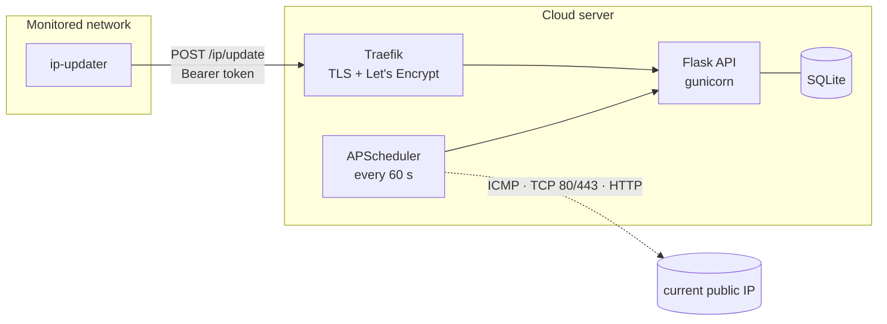

<div align="center">

# Internet Observer

**A small service that watches whether a dynamic-IP connection is reachable from the outside** — a client
reports its current public IP, the server probes that address on a schedule and keeps the history.


</div>

---

## About

Home and small-office connections usually have an IP address that changes, and "is my line reachable
from the internet right now?" can only be answered from the outside. This service is the outside half.

A client, [`aws-internet-observer-ip-updater`](https://github.com/blackburn2601/aws-internet-observer-ip-updater),
runs on the monitored network and reports its public IP. The observer stores it and, every minute,
probes that address with four independent checks (ICMP, TCP 80, TCP 443 and an HTTP request), so you can
tell a dead line from a closed port or a broken web server. Every result is kept in SQLite and can be
queried through a small token-protected API.



## Example

Real output from a local run (container port published on 5099) against `1.1.1.1` as the monitored
address, with the check interval set to 5 seconds.

Without the token the API refuses to answer:

```console
$ curl -i localhost:5099/ip/status
HTTP/1.1 401 UNAUTHORIZED
{"error":"unauthorized"}
```

Report an address, then ask for the current state:

```console
$ curl -X POST -H "Authorization: Bearer $API_TOKEN" -H 'Content-Type: application/json' \
       -d '{"ip":"1.1.1.1"}' localhost:5099/ip/update
{"ip":"1.1.1.1","ok":true,"timestamp":"2026-11-16T15:04:31.520290"}

$ curl -H "Authorization: Bearer $API_TOKEN" localhost:5099/ip/status
{
  "current_ip": "1.1.1.1",
  "ip_updated_at": "Mon, 16 Nov 2026 15:04:31 GMT",
  "last_check": {
    "detail": "PING 1.1.1.1 (1.1.1.1) 56(84) bytes of data. ...",
    "method": "icmp",
    "reachable": 1,
    "time": "Mon, 16 Nov 2026 15:04:39 GMT"
  }
}
```

One round of checks as returned by `/ip/history` (trimmed). The address answers ping and accepts
connections on both ports, but has no `/health` page, which is exactly the distinction the four checks exist to make:

```
time                           method   reachable  detail
Mon, 16 Nov 2026 15:04:39 GMT  icmp     1          PING 1.1.1.1 (1.1.1.1) 56(84) bytes of data.
Mon, 16 Nov 2026 15:04:39 GMT  tcp:80   1          tcp:80 ok
Mon, 16 Nov 2026 15:04:39 GMT  tcp:443  1          tcp:443 ok
Mon, 16 Nov 2026 15:04:39 GMT  http     0          status:404
```

## API

All endpoints require `Authorization: Bearer <API_TOKEN>`.

| Method | Path | Purpose |
|---|---|---|
| `POST` | `/ip/update` | Set the address to monitor. Body `{"ip": "…"}`; if omitted, the caller's address is used |
| `GET` | `/ip/status` | Current IP, when it was reported, and the latest check |
| `GET` | `/ip/history` | The last 200 check results, newest first |

## Checks

Each run, for the stored address:

| Check | Succeeds when |
|---|---|
| `icmp` | `ping -c 2` returns success |
| `tcp:80`, `tcp:443` | a TCP connection opens within 3 s |
| `http` | `GET http://<ip><HTTP_CHECK_PATH>` answers `200` within 5 s |

## Tech stack

| | |
|---|---|
| App | Python 3.11 · Flask 2.2 · gunicorn (2 workers, 2 threads) |
| Scheduling | APScheduler (in-process background scheduler) |
| Storage | SQLite on a named Docker volume |
| Edge | Traefik 2.10: HTTP to HTTPS redirect, Let's Encrypt via HTTP-01 challenge |
| Packaging | One Dockerfile, one Compose file |

## Configuration

| Variable | Default | Meaning |
|---|---|---|
| `API_TOKEN` | placeholder | Bearer token for every endpoint. **Always set it** |
| `CHECK_INTERVAL_SECONDS` | `60` | Time between check rounds |
| `HTTP_CHECK_PATH` | `/health` | Path requested by the HTTP check |
| `DB_PATH` | `/app/monitor.db` (`/app/data/monitor.db` in Compose) | SQLite file |
| `APP_HOST` | | Public hostname Traefik routes to this app (Compose) |
| `LETSENCRYPT_EMAIL` | | Contact address for the Let's Encrypt account (Compose) |

## Getting started

Requires Docker and, for the Compose setup, a hostname pointing at the server with ports 80 and 443 open.

```bash
cat > .env <<EOF
API_TOKEN=$(openssl rand -hex 32)
APP_HOST=observer.example.com
LETSENCRYPT_EMAIL=you@example.com
EOF

docker compose up -d --build
```

To try it locally without Traefik and TLS:

```bash
docker build -t internet-observer .
docker run -d -p 127.0.0.1:5000:5000 -e API_TOKEN=local-test -e CHECK_INTERVAL_SECONDS=10 internet-observer
```

Then point the [ip-updater](https://github.com/blackburn2601/aws-internet-observer-ip-updater) at
`https://<APP_HOST>/ip/update`.

## Known limitations

- **Checks run twice per interval.** gunicorn starts two workers and each one starts its own
  scheduler, so every round is recorded twice. Use `--workers=1`, or move the scheduler into its own process.
- **Placeholder token.** If `API_TOKEN` is not set, the built-in placeholder value is accepted. Always provide one.
- **One monitored address.** The service tracks a single current IP, not a list of targets.
- **No alerting.** Results are stored and queryable, nothing notifies you when a check starts failing.

## Project layout

```
app.py               Flask API, SQLite helpers, check functions, scheduler
Dockerfile           python:3.11-slim + iputils-ping, gunicorn
docker-compose.yml   Traefik (TLS) + the app
traefik/             acme.json placeholder for Let's Encrypt state
```

## License

No license has been chosen yet, so all rights are reserved.
